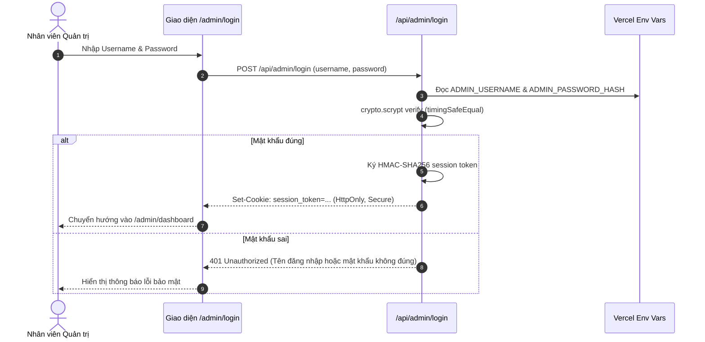
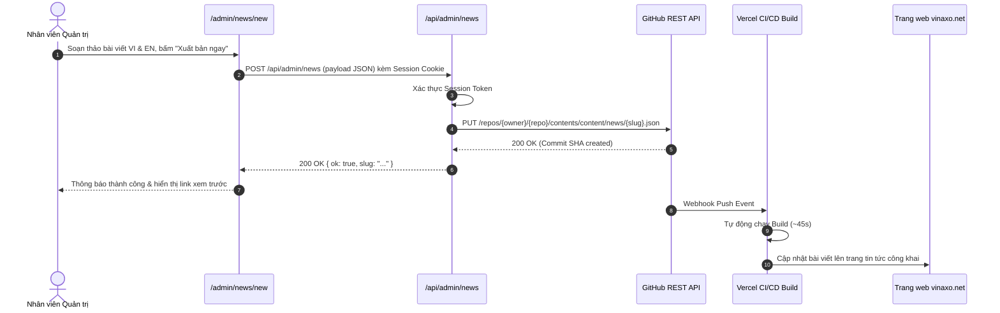
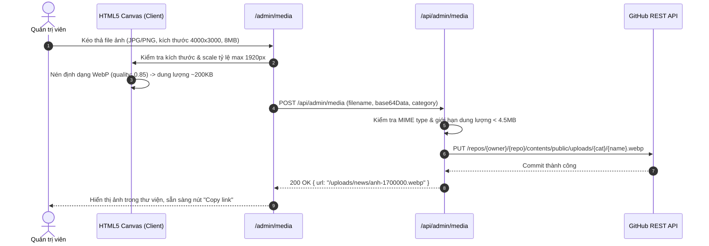

# VINAXO CUSTOM ADMIN & CMS ARCHITECTURE

## 1. TỔNG QUAN HỆ THỐNG

Hệ thống quản trị nội dung VINAXO Custom Admin được thiết kế theo mô hình **Git-backed Headless Enterprise CMS**, giải quyết triệt để vấn đề phụ thuộc vào dịch vụ Database bên ngoài (như Supabase, Firebase) và loại bỏ hoàn toàn rủi ro sleep/pause hoặc chi phí duy trì máy chủ VPS liên tục.

Hệ thống cho phép nhân viên VINAXO đăng nhập bằng **Username và Mật khẩu truyền thống**, không yêu cầu tài khoản GitHub, không sử dụng popup OAuth, và tự động đồng bộ mọi bài viết, sản phẩm, hình ảnh trực tiếp vào kho lưu trữ Git thông qua GitHub REST API.

```
+-------------------------------------------------------------------------------+
|                             VINAXO WEB ECOSYSTEM                              |
+-------------------------------------------------------------------------------+
|                                                                               |
|   +--------------------------+              +-----------------------------+   |
|   |   PUBLIC WEBSITE         |              |   CUSTOM ADMIN PORTAL       |   |
|   |   (React 18 + Vite SPA)  |              |   (/admin/login, dashboard) |   |
|   |   - Build-time loaded    |              |   - HttpOnly Cookie Auth    |   |
|   |   - 0ms DB latency       |              |   - Responsive Desktop/Mobile|  |
|   +------------+-------------+              +--------------+--------------+   |
|                |                                           |                  |
|                | Reads static JSON                         | REST API         |
|                v                                           v                  |
|   +-----------------------------------------------------------------------+   |
|   |                    VERCEL SERVERLESS FUNCTIONS                        |   |
|   |   /api/admin/login     - Native Scrypt verification & Session Cookie  |   |
|   |   /api/admin/logout    - Session termination                          |   |
|   |   /api/admin/session   - HMAC-SHA256 signature verification           |   |
|   |   /api/admin/news      - CRUD News articles via GitHub Trees/Blobs    |   |
|   |   /api/admin/products  - Update product catalogs                      |   |
|   |   /api/admin/media     - Image upload with client-side WebP scaling   |   |
|   |   /api/admin/settings  - Corporate & Brochure configuration           |   |
|   +------------------------------------+----------------------------------+   |
|                                        |                                      |
|                                        | Authenticated Commits                |
|                                        v                                      |
|   +-----------------------------------------------------------------------+   |
|   |                    GITHUB REPOSITORY (lap2004/VINAOX)                 |   |
|   |   content/news/        - 9 bài viết chuẩn JSON song ngữ (VI/EN)       |   |
|   |   content/products/    - 12 sản phẩm nông sản xuất khẩu               |   |
|   |   content/settings/    - company.json & brochure.json                 |   |
|   |   public/uploads/      - Hình ảnh tối ưu hoá WebP                     |   |
|   +------------------------------------+----------------------------------+   |
|                                        |                                      |
|                                        | Webhook Trigger (Auto Build)         |
|                                        v                                      |
|   +-----------------------------------------------------------------------+   |
|   |                    VERCEL PRODUCTION DEPLOYMENT                       |   |
|   |   - Atomic Deployment in ~45 seconds                                  |   |
|   |   - Global Edge CDN Caching                                           |   |
|   +-----------------------------------------------------------------------+   |
+-------------------------------------------------------------------------------+
```

---

## 2. NGUYÊN TẮC THIẾT KẾ & TÍNH NĂNG CỐT LÕI

1. **Zero External Runtime Database**:
   - Dữ liệu được lưu trữ dạng file `.json` và file tĩnh trực tiếp trong Git.
   - Không có nguy cơ bị gián đoạn hoạt động do database ngủ (như gói Free Supabase sau 7 ngày không hoạt động).
   - Chi phí vận hành hạ tầng = 0đ.
2. **Bảo mật tuyệt đối**:
   - Mật khẩu quản trị viên được băm bằng thuật toán `scrypt` tiêu chuẩn Node.js Native Crypto (`N=16384, r=8, p=1, keylen=64`).
   - Phiên đăng nhập lưu trong Cookie có cờ `HttpOnly; Secure; SameSite=Lax`. JavaScript trên trình duyệt không thể đọc trộm cookie này, chống hoàn toàn tấn công XSS.
   - Không lưu trữ Access Token hoặc mật khẩu thô trong mã nguồn hoặc Git.
   - GitHub Token chỉ lưu tại biến môi trường bí mật trên Vercel Serverless Function, hoàn toàn vô hình đối với trình duyệt người dùng.
3. **Thao tác đơn giản cho người dùng không biết kỹ thuật**:
   - Giao diện CMS tiếng Việt chuẩn nhận diện VINAXO (Warm Cream `#FFF7EC`, Chocolate Brown `#3A251B`, Mango Gold `#F4A83A`).
   - Form soạn thảo hỗ trợ song ngữ Tiếng Việt & Tiếng Anh, tự động tạo slug chuẩn SEO.
   - Trình tải ảnh tự động nén WebP ngay tại trình duyệt trước khi tải lên, giữ dung lượng dưới 500KB để không làm phình Git.
4. **Hiệu năng & Tối ưu tải trang**:
   - Toàn bộ module Admin được tách gói riêng biệt (`lazy()` code splitting), không làm tăng kích thước bundle của trang chủ hoặc trang sản phẩm của khách hàng.

---

## 3. QUY TRÌNH HOẠT ĐỘNG (WORKFLOWS)

### 3.1. Quy trình Xác thực & Quản lý Phiên (Authentication Flow)



### 3.2. Quy trình Biên tập & Xuất bản Bài viết (Content Publication Flow)



### 3.3. Quy trình Tối ưu & Tải lên Hình ảnh (Media Upload Flow)



---

## 4. CẤU TRÚC THƯ MỤC NỘI DUNG TRÊN GIT

Hệ thống quản lý dữ liệu hoàn toàn bằng các file cấu trúc tiêu chuẩn:

```
VINAXO/
├── content/
│   ├── news/                     # 9 bài viết tin tức & báo chí
│   │   ├── vinaxo-dong-thap-xuat-khau-2026.json
│   │   ├── oop-3-sao-xoai-say-deo-dong-thap.json
│   │   ├── vtv1-dua-tin-vinaxo-mo-rong-vung-trong.json
│   │   └── ...
│   ├── products/                 # 12 sản phẩm xuất khẩu
│   │   ├── soft-dried-mango.json
│   │   ├── soft-dried-red-dragonfruit.json
│   │   ├── jackfruit-chips.json
│   │   ├── cashew.json
│   │   └── ...
│   └── settings/                 # Cấu hình doanh nghiệp & brochure
│       ├── company.json          # Tên công ty, MST, địa chỉ, hotline, email
│       └── brochure.json         # Tên brochure, năm ấn bản, file PDF
├── public/
│   └── uploads/                  # Hình ảnh tải lên từ CMS
│       ├── news/
│       ├── products/
│       └── certificates/
└── api/
    ├── admin/                    # Vercel Serverless API Endpoints
    │   ├── login.ts
    │   ├── logout.ts
    │   ├── session.ts
    │   ├── news.ts
    │   ├── products.ts
    │   ├── media.ts
    │   └── settings.ts
    └── lib/                      # Thư viện bảo mật & kết nối GitHub
        ├── auth.ts
        └── github.ts
```

---

## 5. THÔNG SỐ KỸ THUẬT & GIỚI HẠN AN TOÀN

| Tiêu chí | Thông số kỹ thuật | Ghi chú an toàn |
| :--- | :--- | :--- |
| **Thuật toán băm mật khẩu** | `scrypt` (N=16384, r=8, p=1, L=64) | Chống tấn công brute-force phần cứng ASIC/GPU |
| **Ký Token Phiên** | HMAC-SHA256 với secret tối thiểu 32 bytes | Ngăn chặn giả mạo hoặc thay đổi username/role |
| **Thời hạn phiên làm việc** | 7 ngày (604,800 giây) | Tự động gia hạn khi có phiên hợp lệ |
| **Giới hạn kích thước ảnh** | 4.5 MB trên server, tự động nén < 500KB tại browser | Chống tràn bộ nhớ serverless và phình Git |
| **Định dạng ảnh hỗ trợ** | WebP, JPEG, PNG | Tự động chuyển đổi WebP để tối ưu SEO |
| **Đường dẫn cho phép ghi (Allowlist)** | `content/news/`, `content/products/`, `content/settings/`, `public/uploads/` | Chống tấn công Path Traversal ghi đè file hệ thống |
