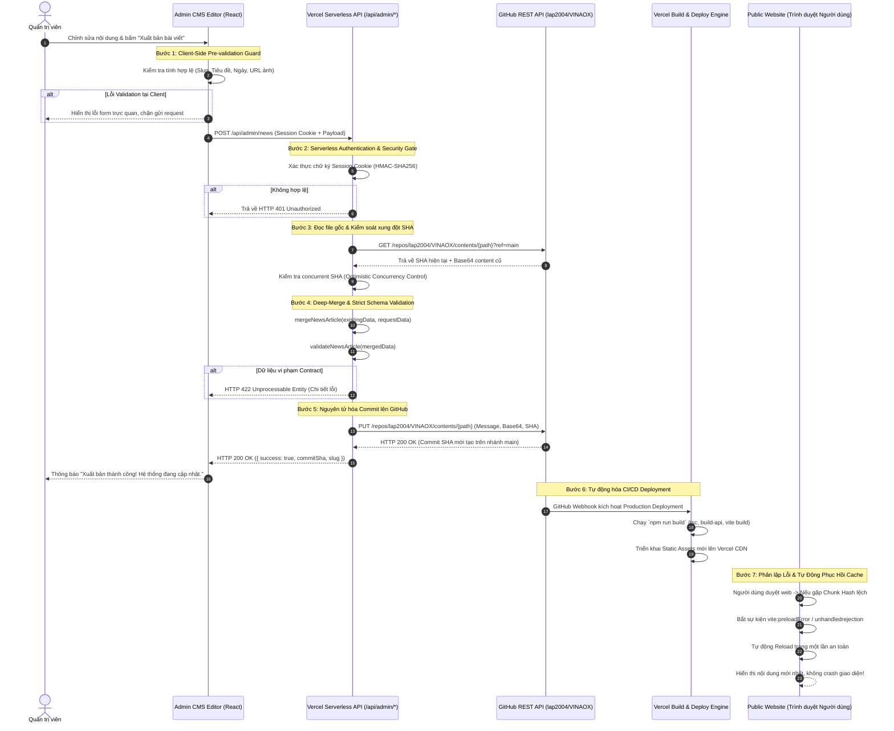

# QUY TRÌNH XUẤT BẢN DỮ LIỆU AN TOÀN (SAFE PUBLISHING PIPELINE)
**Mã tài liệu:** `VINAXO_SAFE_PUBLISHING_PIPELINE`  
**Phiên bản:** 1.0.0  
**Hệ thống:** VINAXO Git-backed Headless Serverless CMS  
**Kiến trúc:** React SPA + Vercel Serverless Functions + GitHub Git REST API  

---

## 1. Sơ đồ Luồng Hoạt động (Publishing Pipeline Flow)

---

## 2. Các Lớp Bảo Vệ Chi Tiết (Defense-in-Depth Gates)

### Gate 1: Client-Side Pre-Validation Guard
- Thực hiện kiểm tra đồng bộ ngay khi người dùng bấm nút "Xuất bản".
- Bắt lỗi tiêu đề quá ngắn, slug sai chuẩn SEO, định dạng ngày tháng không hợp lệ trước khi gửi bất kỳ byte dữ liệu nào qua mạng.

### Gate 2: Xác thực & Phân quyền Serverless
- Kiểm tra session cookie ký bằng scrypt/HMAC-SHA256 bí mật.
- Ngăn chặn triệt để mọi hành vi sửa đổi dữ liệu từ bên ngoài mà không có phiên đăng nhập hợp lệ.

### Gate 3: Kiểm soát Xung đột Đồng thời (Optimistic Concurrency Control)
- Khi nạp bài viết từ GitHub, API lưu giữ mã file SHA của phiên bản hiện tại.
- Khi người dùng gửi lệnh lưu, API so sánh SHA: Nếu có ai khác đã chỉnh sửa file trên GitHub trong thời gian này, API từ chối ghi đè và trả về HTTP 409 Conflict, yêu cầu người dùng nạp lại dữ liệu mới nhất để tránh mất bài viết.

### Gate 4: Deep-Merge & Schema Validation Gate
- API tiến hành hợp nhất dữ liệu mới với dữ liệu cũ đã nạp từ GitHub.
- Các trường bổ sung như trích dẫn báo chí (`personQuoted`), link phụ (`secondaryUrls`), hoặc nội dung tiếng Anh (`content_en`) được bảo toàn tuyệt đối.
- Toàn bộ dữ liệu sau hợp nhất phải vượt qua kiểm tra của `validateNewsArticle` hoặc `validateProduct`. Nếu không đạt, hủy bỏ giao dịch commit.

### Gate 5: Cam kết Nguyên tử (Atomic Git Commit)
- API sử dụng GitHub Contents API để tạo commit trực tiếp trên nhánh production `main`.
- Nội dung commit rõ ràng: `CMS: update news article '{slug}' [skip ci] / production sync`.
- Không phụ thuộc vào môi trường local của người dùng.

### Gate 6: Bảo vệ Tải Chunk & Phục hồi Trình duyệt (Runtime Chunk Healing)
- Cấu hình `vercel.json` định tuyến chuẩn: file assets thiếu trả về 404 thay vì HTML 200.
- `src/main.tsx` bắt lỗi `vite:preloadError` tự động làm mới trang.
- `ErrorBoundary` đa tầng bảo đảm nếu 1 bài viết có hình ảnh lỗi hoặc cấu trúc sai, chỉ bài viết đó hiển thị hộp cảnh báo, toàn bộ khung website VINAXO vẫn hoạt động hoàn hảo.
